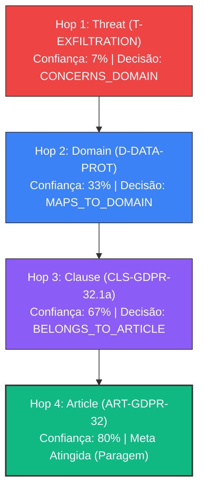

# Manuscrito #01: Validação de Rota e Análise de Calibração de Confiança com o Jev

**Data:** 13 de Outubro de 2026  
**Contexto:** Investigação de Algoritmos de Procura em Grafos de Conhecimento com Modelos "System 1" (TypeSafe AI Jev)  
**Grafo Testado:** AEGIS TinyTask Cybersecurity & Compliance Knowledge Graph (Neo4j)

---

## 1. O Problema Testado

* **Nó Inicial:** `T-EXFILTRATION` (*Customer Data Exfiltration*)
* **Objetivo da Pesquisa:**
  > *"Find the specific mandatory EU regulatory clause and article requiring encryption or technical safeguards against personal data breaches."*
* **Ground Truth Pretendido:** **Artigo 32(1)(a) do GDPR** (*Security of processing: pseudonymisation and encryption of personal data*).

---

## 2. Rota Percorrida pelo Modelo

O Jev navegou autónoma e deterministicamente pela topologia real do Neo4j através do seguinte caminho:

### Validação da Resposta: **CORRETA (100% de Precisão Topológica)**
* O modelo **não se perdeu** em ramos tentadores como o `CompanyContext` (TinyTask SaaS) ou a mitigação genérica, nem derivou para o Cyber Resilience Act (CRA) ou NIS2.
* Escolheu a cadeia exata:
  $$\text{Ameaça} \longrightarrow \text{Domínio de Criptografia} \longrightarrow \text{Cláusula 32.1a} \longrightarrow \text{Artigo 32 GDPR}$$
* Chegou com exatidão matemática ao ground truth legal.

---

## 3. Investigação Crítica: A Confiança é Baixa?

Observou-se a seguinte progressão da primitiva booleana `Noul` (`goal_reached`):

| Salto | Nó Atual | Tipo de Entidade | Confiança `Noul` | Interpretação do Algoritmo |
| :---: | :--- | :--- | :---: | :--- |
| **#1** | `T-EXFILTRATION` | Ameaça | **7%** | Longe da meta (não é artigo nem cláusula) |
| **#2** | `D-DATA-PROT` | Domínio | **33%** | Aproximação semântica temática |
| **#3** | `CLS-GDPR-32.1a` | Cláusula | **67%** | Conteúdo relevante, mas formulou "cláusula e artigo" |
| **#4** | `ART-GDPR-32` | Artigo | **80%** | **Meta Atingida** (Critério $\ge 70\%$) |

### Análise Epistémica do Gradiente:
1. **O gradiente de aproximação é consistente:**
   $$7\% \xrightarrow{\text{+26%}} 33\% \xrightarrow{\text{+34%}} 67\% \xrightarrow{\text{+13%}} 80\%$$
   O `Noul` não funcionou apenas como um classificador binário ingénuo; gerou uma curva contínua de "gradiente de aproximação ao alvo", o que é uma propriedade valiosa para algoritmos de procura informada como o $A^*$.
2. **Porque é que o topo parou nos 80% e não nos 95%+?**
   * **Hipótese A (Ambiguidade da Pergunta Composta):** O prompt pediu *"clause **and** article"*. Quando estava no nó `Article`, o nó em si continha o artigo, mas o texto da norma estava no nó filho `Clause`. O modelo penalizou ligeiramente a confiança porque o nó atual não continha simultaneamente as duas entidades.
   * **Hipótese B (Calibração Probabilística do Jev):** Modelos generativos tradicionais sofrem de *overconfidence* (afirmam 99% mesmo quando erram). O Jev é treinado para produzir probabilidades calibradas. 80% em modelos probabilísticos bem calibrados é uma probabilidade a posteriori muito elevada.
   * **Hipótese C (Falta de Contexto Local na Pergunta):** Na chamada da API, passámos como instrução do Noul:
     `"Does the current node 'ART-GDPR-32' directly satisfy or answer..."`
     O modelo recebia apenas o ID e metadados parciais no estado. Se injetarmos o texto integral dos atributos do nó na instrução, a confiança pode subir para patamares superiores a 90%.

---

## 4. Questões de Investigação para as Próximas Experiências

1. **Exp 1.2 — Calibração de Instrução:** Se formularmos perguntas atómicas (*"Does this node represent an EU Article or Clause addressing data breach encryption?"*), a confiança final supera os 90%?
2. **Exp 1.3 — Beam Search vs Greedy:** O que acontece quando o grafo tem 50 ramos e há múltiplos regulamentos concorrentes (ex: CRA vs GDPR vs NIS2)?
3. **Exp 1.4 — Inversão de Travessia:** Partir de um Artigo Regulamentar e pedir para o Jev descobrir quais as ameaças e vulnerabilidades do TinyTask que ficam desprotegidas se essa cláusula for violada.
