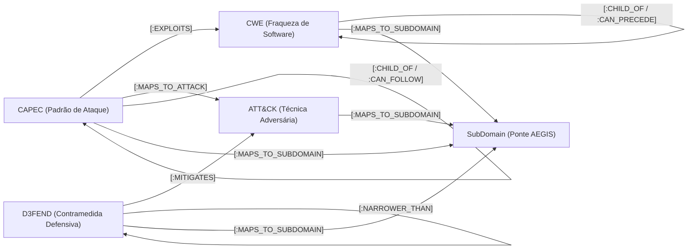

# Manuscrito #02 — Navegação Semântica com Jev sobre Ontologias de Cibersegurança (CWE, CAPEC, ATT&CK, D3FEND)

**Data:** 13 de Outubro de 2026  
**Autor:** Antigravity & Paulo Ribeiro  
**Contexto:** TypeSafe AI Jev (System 1) + Neo4j Threat Intelligence Knowledge Graph  

---

## 1. Contexto e Motivação da Transição de Grafo

Nas experiências iniciais do repositório (documentadas no [Manuscrito #01](file:///c:/Users/paulo.ribeiro/OneDrive%20-%20Instituto%20CCG%20ZGDV/Documentos/Repositorios/Jev/manuscritos/01_traversal_confidence_analysis.md)), foi utilizado um grafo conceitual simplificado (*TinyTask Compliance KG* com 25 nós) para validar a hipótese de calibração de confiança probabilística (`Noul`).

Contudo, para cenários reais de modelação de ameaças (*Threat Modeling*) e arquitetura defensiva, é imperativo utilizar ontologias técnicas normalizadas internacionalmente. A transição realizada neste marco substitui os grafos sintéticos pelo **Grafo Unificado de Inteligência de Ameaças**, integrando:
1. **CAPEC (Common Attack Pattern Enumeration and Classification):** 615 padrões de ataque.
2. **CWE (Common Weakness Enumeration):** 969 tipos de vulnerabilidades e falhas de software.
3. **MITRE ATT&CK:** 836 técnicas e subtécnicas de adversários.
4. **MITRE D3FEND:** 466 contramedidas e técnicas defensivas de cibersegurança.
5. **AEGIS SubDomains & Domains:** 38 subdomínios taxonómicos que servem como nós de ponte transversal.

---

## 2. Topologia do Grafo e Relações Cross-Framework

O grafo reside localmente em Neo4j (`bolt://localhost:7687`), contendo mais de **2.900 nós** e mais de **12.000 relações**, destacando-se as seguintes conexões semânticas:

### Métricas de Conectividade em Neo4j:
* `CWE`: 969 nós
* `ATTACK`: 836 nós
* `CAPEC`: 615 nós
* `D3FEND`: 466 nós
* `SubDomain` / `Domain`: 52 nós
* `[:MAPS_TO_SUBDOMAIN]`: 5.121 relações
* `[:MITIGATES]`: 3.234 relações (D3FEND ➔ ATT&CK)
* `[:CHILD_OF]`: 1.692 relações
* `[:EXPLOITS]`: 1.212 relações (CAPEC ➔ CWE)
* `[:MAPS_TO_ATTACK]`: 271 relações (CAPEC ➔ ATT&CK)
* `[:NARROWER_THAN]`: 389 relações

---

## 3. Papel do Jev (System 1) na Travessia de Grafos Técnicos

Modelos geradores tradicionais (LLMs / System 2) sofrem com três problemas críticos neste domínio:
1. **Alucinação de IDs e Relações:** Podem inventar arestas inexistentes entre CWEs e técnicas defensivas.
2. **Latência de Geração:** Gerar texto token-a-token impõe latências de centenas ou milhares de milissegundos por salto.
3. **Custo de Contexto:** Injetar esquemas de milhares de arestas esgota janelas de contexto e encarece as chamadas.

O **Jev** contorna estas limitações ao atuar em modo probabilístico puro sobre o estado e as arestas válidas extraídas deterministicamente do Neo4j:
* **`Noul` (Critério de Paragem / Meta):** Avalia se o nó atual responde diretamente ao objetivo do utilizador (ex.: se chegámos a uma contramedida D3FEND satisfatória).
* **`Choice` (Seleção Categórica de Ramo):** Escolhe qual das arestas adjacentes (`branch_1`, `branch_2`, ...) é semanticamente mais promissora para avançar.
* **`Score` (Função Heurística $h(n)$):** Atribui uma pontuação ordinal de alinhamento para guiar algoritmos informados (A* ou Best-First Search).

---

## 4. Teste Empírico: Salto de Procura a partir de `CAPEC-1`

### Parâmetros do Teste:
* **Nó Inicial:** `CAPEC-1` (*Accessing Functionality Not Properly Constrained by ACLs*)
* **Objetivo de Procura:** *"Find the D3FEND defensive countermeasure or verification technique that mitigates software file permissions or access control weaknesses."*
* **Ramos Adjacentes Extraídos de Neo4j:**
  * `branch_1`: `[:CHILD_OF] ➔ [CAPEC] CAPEC-122 (Privilege Abuse)`
  * `branch_2`: `[:CHILD_OF] ➔ [CAPEC] CAPEC-58 (Restful Privilege Elevation)`
  * `branch_3`: `[:CHILD_OF] ➔ [CAPEC] CAPEC-679 (Exploitation of Improperly Configured Memory Protections)`
  * `branch_4`: `[:CHILD_OF] ➔ [CAPEC] CAPEC-680 (Exploitation of Improperly Controlled Registers)`
  * `branch_5`: `[:CHILD_OF] ➔ [CAPEC] CAPEC-681 (Exploitation of Improperly Controlled Hardware Security Identifiers)`
  * `branch_6`: `[:CAN_PRECEDE] ➔ [CAPEC] CAPEC-17 (Using Malicious Files)`

### Decisão do Jev:
* **Latência:** ~345 ms (chamada completa de rede HTTPS)
* **Goal Confidence (`Noul`):** `6.0%`
  * O Jev reconheceu corretamente que `CAPEC-1` é um padrão de ataque ofensivo e **não** uma contramedida defensiva, evitando falsos positivos de paragem prematura.
* **Seleção de Ramo (`Choice`):** Escolheu `branch_1` (`CAPEC-122 - Privilege Abuse`), o ramo com maior relação ontológica e gravidade em controlo de acessos.
* **Alignment Score:** `0.35` (relevância inicial consistente com o ponto de partida do ataque).

---

## 5. Arquitetura da Interface e Visualizador Interativo

A aplicação Streamlit (`app/graph_ui.py`) em execução em `http://localhost:8501` foi adaptada para garantir:
1. **Isolamento e Foco no Grafo de Ameaças:** Todos os nós sintéticos antigos foram expurgados; o sistema consulta exclusivamente nós e arestas de cibersegurança.
2. **Visualização por Rede Egoica (*Ego-Network*):** Para evitar congelamento do browser num grafo denso de 3.000 nós, a interface renderiza dinamicamente o caminho percorrido mais a fronteira ativa de 1 e 2 saltos, garantindo 60 FPS fluido no Vis.js.
3. **Paleta Semântica Diferenciada:**
   * Laranja (`#F97316`): `CAPEC` (Padrões de Ataque)
   * Roxo (`#8B5CF6`): `CWE` (Fraquezas de Código)
   * Vermelho (`#EF4444`): `ATTACK` (Técnicas Adversárias)
   * Verde Esmeralda (`#10B981`): `D3FEND` (Técnicas Defensivas)
   * Ciano (`#06B6D4`): `SubDomain` (Pontes de Taxonomia AEGIS)
4. **Inspeção em Tempo Real:** Cada salto regista o Cypher exato executado, tempo de resposta em milissegundos, payload JSON do estado e respostas probabilísticas do Jev.

---

## 6. Próximos Passos Experimentais

1. **Benchmark de Caminhos Completos (Attack-to-Defense):** Medir a taxa de sucesso do Jev em atingir a contramedida D3FEND ótima a partir de 20 padrões CAPEC conhecidos em menos de 4 saltos.
2. **Comparação Heurística:** Integrar o valor `Score` do Jev como função heurística num algoritmo A* contra uma procura cega (BFS/DFS).
3. **Registo de Métricas:** Publicar tempos de expansão e custos por nó explorado em `benchmarks/`.
