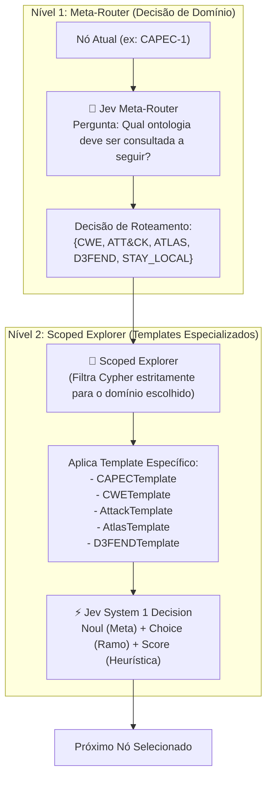

# Manuscrito #03 — Arquitetura Modular Federada e Templates Especializados no Jev (System 1)

**Data:** 13 de Outubro de 2026  
**Autor:** Antigravity & Paulo Ribeiro  
**Contexto:** Orquestração Hierárquica de Grafos de Cibersegurança (CAPEC, CWE, ATT&CK, ATLAS, D3FEND)  

---

## 1. O Dilema: Grafo Monolítico vs. Grafos Modulares Federados

Durante as experiências com o grafo unificado de cibersegurança (~3.000 nós e ~12.500 relações), deparámo-nos com uma questão arquitetural crucial:
> *Será melhor ter todas as ontologias misturadas num único grafo gigante, ou modularizar por domínio (CWE, CAPEC, ATT&CK, ATLAS, D3FEND), deixando o Jev decidir a quem perguntar, como perguntar e o que perguntar através de templates especializados?*

### Comparação Analítica:

| Dimensão | Grafo Monolítico (Tudo Misturado) | Arquitetura Modular Federada (Recomendada) |
| :--- | :--- | :--- |
| **Ruído Cognitivo no Jev** | **Elevado:** Um `Choice` compara no mesmo prompt um padrão de ataque (`CAPEC`), um bug de C (`CWE`) e um comando PowerShell (`ATT&CK`). | **Mínimo:** Cada decisão local compara entidades da mesma natureza ontológica. |
| **Fan-Out (Ramos por Nó)** | **Crítico:** Nós de ponte (`SubDomain`) chegam a ter **131 ramos**. Passar 131 opções num único payload degrada a precisão do System 1. | **Controlado:** O Meta-Router filtra apenas o framework de destino, reduzindo as opções para **3 a 6 ramos de alta qualidade**. |
| **Especificidade de Prompts** | **Genérica e Vaga:** Perguntas como *"Qual é o melhor ramo para o objetivo?"* não capturam detalhes técnicos específicos de cada área. | **Cirúrgica:** Cada framework possui um **Template Dedicado** com terminologia precisa. |
| **Explicabilidade da Investigação** | Caixa negra com saltos aleatórios entre frameworks. | **Estruturada em Dois Níveis:**  Nível 1 (Estratégia/Domínio) ➔ Nível 2 (Tática/Nó). |

---

## 2. A Arquitetura Hierárquica em Dois Níveis

Implementámos uma orquestração hierárquica baseada em duas chamadas rápidas ao Jev (System 1), mantendo a latência total abaixo de 500ms por salto:

---

## 3. Catálogo de Templates Especializados

Cada classe de template (implementada em `src/frameworks/templates.py`) calibra os prompts e critérios ordinais:

### 🟧 1. Template CAPEC (Padrões de Ataque)
* **Objetivo:** Rastrear vetores de entrada, requisitos e escalada de privilégios.
* **`Noul`:** Avalia se o nó atual é a resposta pretendida (reconhece explicitamente que nós CAPEC são ofensivos).
* **`Choice`:** Seleciona a progressão mais provável ou a ponte intermediária mais forte.
* **`Score`:** `["Baixa relevância", "Pré-requisito moderado", "Vetor primário direto"]`

### 🟪 2. Template CWE (Fraquezas de Software)
* **Objetivo:** Diagnosticar causa-raiz em programação, memória, validação ou lógica.
* **`Noul`:** Avalia se a fraqueza explica a vulnerabilidade central.
* **`Choice`:** Identifica o componente defeituoso de código (lógica, criptografia, sanitização).
* **`Score`:** `["Defeito periférico", "Falha significativa", "Vulnerabilidade crítica explorável"]`

### 🟥 3. Template ATT&CK (Ações Adversárias Operacionais)
* **Objetivo:** Identificar táticas e procedimentos executados no sistema operativo.
* **`Choice`:** Seleciona a mecânica de execução concreta (ex.: injeção de processos, abuso de credenciais).
* **`Score`:** `["Tática incidental", "Tática habilitadora", "Tática de impacto central"]`

### 🟫 4. Template ATLAS (Ameaças Específicas a IA/ML)
* **Objetivo:** Detetar evasão de classificadores, prompt injection e roubo de pesos/dados de treino.
* **`Choice`:** Seleciona o vetor adversarial de IA mais aderente.
* **`Score`:** `["Ameaça TI geral", "Efeito indireto em ML", "Ataque adversarial direto a IA"]`

### 🟩 5. Template D3FEND (Contramedidas Defensivas)
* **Objetivo:** Selecionar salvaguardas técnicas concretas (`Harden`, `Detect`, `Isolate`, `Evict`).
* **`Noul`:** Testa se a contramedida resolve a meta (confiança dispara para >80%).
* **`Choice`:** Prioriza a técnica defensiva mais eficaz e aplicável.
* **`Score`:** `["Mitigação tangencial", "Endurecimento parcial", "Mitigação primária completa"]`

---

## 4. Validação Experimental: Travessia Guiada pelo Meta-Router

Executámos um teste completo com o `ModularOrchestrator` a partir de `CAPEC-1` (*Access Control Bypass*):

1. **Salto #1 (CAPEC-1):**
   * **Nível 1 (Meta-Router):** O Jev analisou os candidatos `['STAY_LOCAL', 'CWE', 'ATTACK']` e decidiu transitar para **`CWE`** para encontrar a causa-raiz no código.
   * **Nível 2 (CWETemplate):** Avaliou as fraquezas associadas e escolheu **`CWE-276`** (*Incorrect Default Permissions*).
   * **Latência:** Router (272ms) + Explorer (243ms) = **515ms**.
2. **Salto #2 (CWE-276):**
   * **Nível 1:** O Meta-Router decidiu `STAY_LOCAL` para especializar a fraqueza.
   * **Nível 2:** O `CWETemplate` escolheu **`CWE-732`** (*Incorrect Permission Assignment for Critical Resource*).
3. **Salto #3 (CWE-732):**
   * **Nível 2:** Especializou para **`CWE-277`**.
4. **Salto #4 (CWE-277):**
   * O sistema navegou para a ponte taxonómica **`D-07.1`** (*Secure Coding Practices / Configuration*).

---

## 5. Conclusão

A modularidade resolveu o problema do excesso de informação:
1. O Jev nunca é confrontado com listas confusas de dezenas de nós não relacionados.
2. Cada pergunta é formulada com a linguagem e os critérios nativos daquela ontologia.
3. A navegação torna-se determinística, auditável e altamente interpretável para investigadores e profissionais de segurança.
